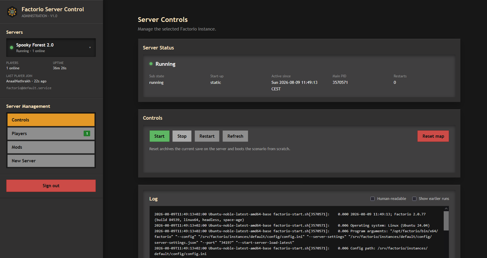

# Factorio Server Control

An Ansible-managed Factorio headless server with a secure web console for
operating multiple isolated game instances.

The project provisions Factorio, systemd services, nginx, and the FastAPI-based
FUI from one declarative configuration. It supports fresh servers, existing
saves, custom scenarios, and pre-provisioned upload slots without giving the
web application unrestricted root access.

## Highlights

- Multiple servers sharing one read-only Factorio installation.
- Isolated state, configuration, runtime data, ports, saves, and mods.
- Start, stop, restart, map reset, status, uptime, and player activity.
- Human-readable journal logs and current mod inventory.
- Exact save-required mod synchronization with checksum verification.
- Transactional save uploads into configurable dormant server slots.
- Password login with signed sessions and throttling.
- Fixed systemd, filesystem, and sudo allow-lists generated by Ansible.



## Architecture

```text
Browser -> nginx -> FUI (FastAPI) -> allow-listed systemd/helpers
                              |
                              +-> journald, saves, and mod metadata

Ansible -> Factorio + systemd + FUI + nginx
```

Factorio binaries live under `/opt/factorio`. Instance data is consolidated
under `/srv/factorio/instances/<id>/{state,config,runtime}`. Game processes run
as the unprivileged `factorio` account; FUI runs separately as `fui`.

## Quick Start

Start with [docs/INSTALL.md](docs/INSTALL.md). After SSH and the local encrypted
vault are ready, continue with [docs/OPERATIONS.md](docs/OPERATIONS.md) to
configure and deploy instances.

```bash
cd ansible
export ANSIBLE_CONFIG="$PWD/ansible.cfg"
ansible-playbook site.yml --syntax-check
ansible-playbook site.yml --ask-vault-pass
```

`ansible/vault.yml`, custom instance configuration, keys, saves, scenario
implementations, and private deployment notes are intentionally excluded from
Git. Tracked example files document the required structure.

## Repository

```text
ansible/       Provisioning, roles, templates, and example configuration
docs/          Installation, operations, and development guides
fui/           FastAPI web console and tests
githooks/      Repository safety hooks
mods/          Optional repository-managed mod archives
scenarios/     Local scenario staging area; only its README is tracked
```

## Documentation

- [Installation](docs/INSTALL.md): prerequisites, SSH, and vault setup.
- [Operations](docs/OPERATIONS.md): instances, deployment, verification,
  backups, and upgrades.
- [Development](docs/DEVELOPMENT.md): local setup, tests, architecture, API,
  and security invariants.
- [Changelog](CHANGELOG.md): release history.
- [Scenario staging](scenarios/README.md): local scenario layout and deployment.
- [License](LICENSE.md): project MIT license.
- [Third-party notices](fui/THIRD_PARTY_NOTICES.md): upstream attribution and
  license notice.

`MYDEPLOYMENT.md` is an ignored local runbook for host-specific information.
